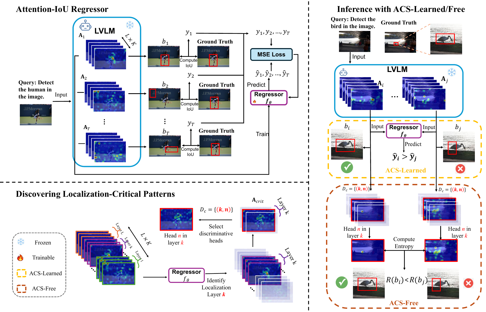

<div align="center">

# Self-Improving Small Object Grounding in LVLMs

**Tianze Yang · Yucheng Shi · Ruitong Sun · Ninghao Liu · Jin Sun**

University of Georgia

**WACV 2027**

[](https://groundvlm.github.io/)
[](https://groundvlm.github.io/paper.pdf)
[](https://huggingface.co/groundvlm/ACS-Learned)
[](https://huggingface.co/datasets/groundvlm/ACS-attention-Qwen2.5-VL-COCO)

</div>

<p align="center">
  
</p>

**Can the internal attention of a Large Vision Language Model (LVLM) tell which small-object boxes are reliable, without any fine-tuning?** Yes. A lightweight IoU regressor trained *only* on attention maps predicts box quality well (Pearson *r* > 0.67). We use this to build **Attention-based Candidate Selection (ACS)**. ACS samples several candidate boxes from a frozen LVLM and keeps the one its attention trusts most:

- **ACS-Learned** scores each candidate with the trained Attention-IoU Regressor and keeps the highest predicted IoU.
- **ACS-Free** has no learned component at inference. It ranks candidates by attention entropy on a few discriminative heads, found by analysing the regressor.

On small objects in COCO and Objects365, ACS improves Qwen2.5-VL-7B and InternVL-3.5-8B by up to **19%** (relative Acc@0.5 over greedy decoding). Neither the LVLM nor an external detector is fine-tuned.

## Results

Small-object grounding, 2,225 instances per dataset, 10 sampled candidates per query at τ = 0.5. Each cell is Acc@0.5 / mIoU (%).

| Method | Qwen2.5-VL COCO | Qwen2.5-VL Objects365 | InternVL-3.5 COCO | InternVL-3.5 Objects365 |
|---|:---:|:---:|:---:|:---:|
| Greedy decoding | 61.4 / 52.2 | 43.0 / 36.9 | 49.1 / 42.9 | 21.9 / 21.9 |
| **ACS-Free** | 63.4 / 53.5 | 43.0 / 37.9 | 53.1 / 47.4 | 24.8 / 24.4 |
| **ACS-Learned** | **65.3 / 55.2** | **45.1 / 39.1** | **58.6 / 50.6** | **25.5 / 24.9** |

All temperatures (τ ∈ {0.5, 0.7, 1.0}) are in [`SUMMARY.tsv`](SUMMARY.tsv). There, `regression` = ACS-Learned and `entropy` = ACS-Free. The selection behind every number is committed under `<model>/evaluation/selection_csvs/`, one row per image.

## Repository layout

```
├── qwen2.5_small/               Qwen2.5-VL-7B   (28 layers × 28 heads, attention resized to 24×24)
│   ├── extraction/              sample candidate boxes from the LVLM and save per-coordinate attention
│   ├── regression/              ACS-Learned: Attention-IoU Regressor (data prep, train, test)
│   ├── entropy/                 ACS-Free: entropy-based selection on the discovered heads
│   └── evaluation/              Acc@0.5 / mIoU evaluator + committed selection CSVs
├── internvl_3.5_small/          InternVL-3.5-8B (36 layers × 32 heads, native 16×16 attention); same layout
├── dataset_splits/              the small-object instances used for training and testing
├── assets/                      figures
└── SUMMARY.tsv                  every number in the main table
```

## Installation

```bash
conda create -n acs python=3.10 -y && conda activate acs
pip install -r requirements.txt
```

You only need `transformers` (and `qwen-vl-utils` for Qwen) to re-generate candidates with the LVLM (Step 0). We used `transformers==4.49.0` for Qwen2.5-VL and `transformers==4.55.4` for InternVL-3.5.

## Reproduce ACS on Qwen2.5-VL · COCO · τ = 0.5

This uses the released attention maps, so you do not need to run the LVLM.

### 1. Download weights and data

```bash
# ACS-Learned weights (one regressor per LVLM)
huggingface-cli download groundvlm/ACS-Learned --local-dir weights

# Cached candidates + attention maps for Qwen2.5-VL / COCO / τ = 0.5 (≈45 GB compressed)
huggingface-cli download groundvlm/ACS-attention-Qwen2.5-VL-COCO --repo-type dataset --local-dir hf_data
mkdir -p data && for f in hf_data/*.tar.gz; do tar -xzf "$f" -C data; done
```

After extraction, `data/` looks like this:

```
data/object_detection_Qwen/
├── regression_training/processed_data/COCO/single_object/temp_0.5_top_p_0.9_response_10/
│   ├── test_list.csv            one row per candidate box (25,626)
│   └── test/*.pkl               attention of every layer/head for the 4 coordinate tokens
└── model_response/COCO/testing/single_object/bbox_attention_temp_0.5_top_p_0.9_response_10/
    └── <image>/response_<k>.pkl predicted boxes + ground truth, used by the evaluator
```

If you put the data somewhere else, `export DATA_ROOT=/path/to/data`. All scripts read `DATA_ROOT`, which defaults to `<repo>/data`.

### 2. ACS-Free (CPU)

```bash
bash qwen2.5_small/entropy/run_select.sh 0.5 COCO     # rank candidates by attention entropy on the 12 discovered heads
bash qwen2.5_small/entropy/run_eval.sh   0.5 COCO     # → Accuracy 0.6337, Mean IoU 0.5349
```

### 3. ACS-Learned (1 GPU)

```bash
bash qwen2.5_small/regression/run_test.sh 0.5 COCO    # → Accuracy 0.6526, Mean IoU 0.5523
```

`run_test.sh` scores every candidate with the regressor, keeps the argmax per image, and evaluates the result. Pass a different checkpoint with `CKPT=/path/to/model.pth` and a different interpreter with `PYTHON=...`.

## Full pipeline (other models, datasets and temperatures)

### Step 0: sample candidates and extract attention

Download the COCO 2017 images (`train2017/`, `val2017/`) into `dataset_splits/COCO/` and the Objects365 test images into `dataset_splits/Objects365/images/`. Then run:

```bash
cd qwen2.5_small/extraction             # or internvl_3.5_small/extraction
python batch_bbox_attention_processor.py \
    --dataset COCO --data_type testing --object_num single \
    --temperature 0.5 --top_p 0.9 --top_k 100 --num_responses 10
# --model_path defaults to Qwen/Qwen2.5-VL-7B-Instruct (InternVL: OpenGVLab/InternVL3_5-8B-HF)
```

This writes one pkl per (image, response) under `./model_response/`. Move it to `$DATA_ROOT/object_detection_<Qwen|InternVL>/model_response/`. The InternVL folders have no `single_object/` level.

### Step 1: split candidates into per-box attention files

```bash
cd qwen2.5_small/regression
python data_processing.py --data_type testing --dataset COCO --temperature 0.5    # model_response → processed_data
# InternVL: set data_type / dataset_name / temperature at the bottom of internvl_3.5_small/regression/data_processing.py
```

### Step 2: train the Attention-IoU Regressor (optional; released weights are on 🤗)

```bash
python train.py --config config.yaml    # trained once on τ = 1.0 training data, reused for every τ
```

### Step 3: run ACS-Learned / ACS-Free for any setting

```bash
bash qwen2.5_small/regression/run_test.sh  <τ> <COCO|Objects365>
bash qwen2.5_small/entropy/run_select.sh   <τ> <COCO|Objects365>
bash qwen2.5_small/entropy/run_eval.sh     <τ> <COCO|Objects365>
```

## ACS-Free heads

These are the discovered (layer, head) pairs, three per coordinate token. They are already set in `entropy/run_select.sh`.

| LVLM | x1 | y1 | x2 | y2 |
|---|---|---|---|---|
| Qwen2.5-VL | (20,15) (21,22) (19,23) | (20,14) (20,19) (18,15) | (19,27) (19,23) (18,15) | (20,26) (14,16) (20,16) |
| InternVL-3.5 | (21,19) (23,30) (18,5) | (24,31) (21,28) (24,21) | (21,19) (21,23) (22,0) | (21,23) (24,11) (21,29) |

## Citation

```bibtex
@inproceedings{yang2027acs,
  title     = {Self-Improving Small Object Grounding in LVLMs},
  author    = {Yang, Tianze and Shi, Yucheng and Sun, Ruitong and Liu, Ninghao and Sun, Jin},
  booktitle = {Proceedings of the IEEE/CVF Winter Conference on Applications of Computer Vision (WACV)},
  year      = {2027}
}
```
